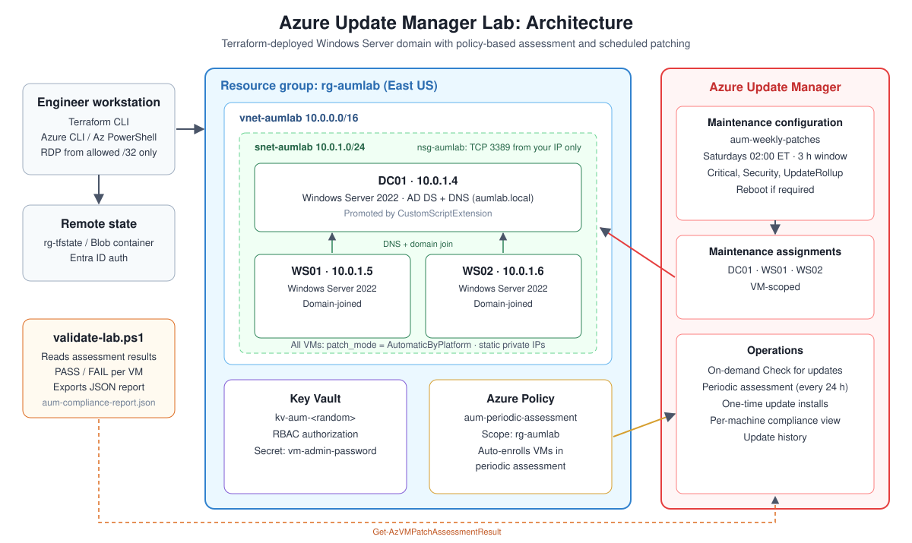
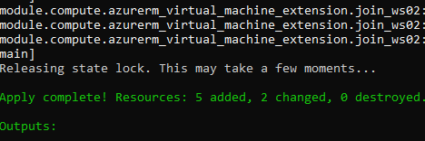
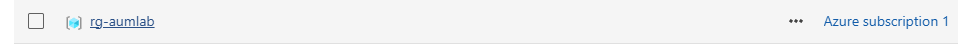
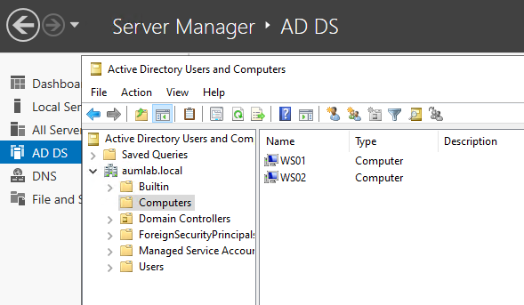
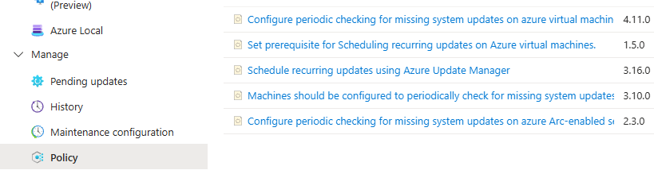
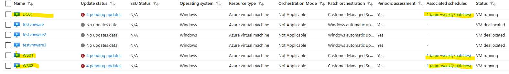
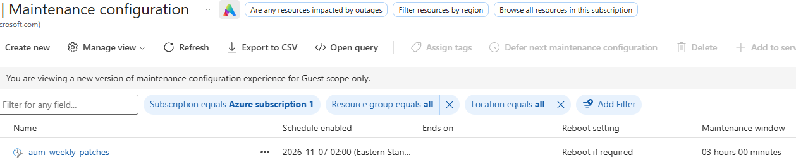
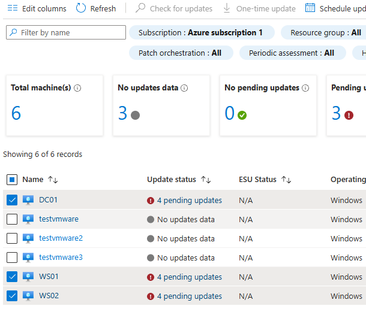
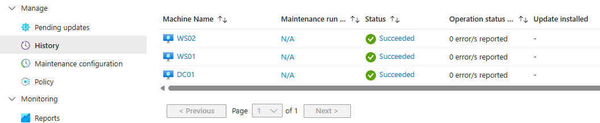

# Azure Update Manager Lab: Patch Management Pipeline with Terraform

Terraform builds a small Windows Server Active Directory environment in Azure, then Azure Update Manager, Azure Policy, and a PowerShell validation script handle its patch management: assessment, scheduled patching, and compliance reporting.


---

## The Business Problem This Lab Solves

Unpatched systems are one of the most common root causes of security incidents. A Windows Server missing current Critical and Security patches is a known vulnerability. The challenge at scale is not applying patches to one server — it is knowing which machines across an entire environment are missing which patches, enforcing a consistent schedule, and producing documentation that proves compliance to auditors.

In traditional on-premises environments this was handled by WSUS — a server you had to run, maintain, and keep updated yourself. Azure Update Manager is the cloud-native replacement. It is agentless for Azure VMs, integrates with Azure Policy for automatic enrollment, maintains a compliance record per machine, and supports both scheduled patching and manual approval workflows.

This lab builds a complete patch management pipeline from zero: infrastructure deployment, policy-based enrollment, maintenance window configuration, on-demand assessment, compliance validation, and structured report export. Every step maps directly to what a cloud operations team does in production.

---

## How This Lab Solves It

Each challenge from the business problem maps to a specific part of this build, and a screenshot from the running lab proves it.

| Business challenge | Solution in this lab | Proof |
|---|---|---|
| **Know which machines are missing which patches** | Azure Policy (`aum-periodic-assessment`) enforces periodic assessment, and on-demand **Check for updates** gives an immediate picture | All three VMs show *Periodic assessment: Yes*, and the assessment found **4 pending updates on each VM** ([03](docs/images/03-aum-machines.png), [06](docs/images/06-assessment-results.png)) |
| **Enforce a consistent patch schedule** | One maintenance configuration (`aum-weekly-patches`): Saturdays 02:00 ET, 3-hour window, Critical + Security + UpdateRollup, reboot if required, assigned to every VM | Each VM shows *Associated schedules: 1 (aum-weekly-patches)* ([03](docs/images/03-aum-machines.png), [04](docs/images/04-maintenance-config.png)) |
| **Enroll machines automatically, not by hand** | VMs are created with `AutomaticByPlatform` patch orchestration, and the policy assignment covers the whole resource group | *Patch orchestration: Customer Managed Schedules* on all lab VMs, while unmanaged VMs in the subscription stay out of scope ([03](docs/images/03-aum-machines.png), [05](docs/images/05-policy-compliance.png)) |
| **Prove compliance to auditors** | Update Manager keeps a per-machine record and run history, and `validate-lab.ps1` exports a timestamped JSON compliance report with PASS/FAIL per VM | History shows **Succeeded, 0 errors** on DC01, WS01, and WS02 ([08](docs/images/08-update-history.png)) |
| **Support scheduled and manual approval workflows** | The weekly window handles routine patching, and `az vm install-patches` runs one-time, approved installs | Commands documented in the walkthrough below |
| **Eliminate WSUS server overhead** | No patch server to build, patch, or back up. Update Manager is a managed Azure service, and the entire environment is reproducible from Terraform | Full environment deployed with `terraform apply` ([01](docs/images/01-terraform-apply.png)) |

### Outcome

Starting from an empty resource group, the lab delivers a three-server Windows domain that is automatically enrolled in patch assessment and on a fixed weekly patch schedule, with an audit trail in Update Manager. The assessment surfaced 4 pending updates per server, which the weekly maintenance window is scheduled to remediate. The whole pipeline can be rebuilt or torn down with one command.

---

## Architecture



---

## Features

| Area | What the lab does |
|---|---|
| **Infrastructure as code** | Four Terraform modules (`networking`, `keyvault`, `compute`, `update-manager`), with remote state in an Azure Storage backend that uses Entra ID auth |
| **Domain environment** | DC01 is promoted to a domain controller for `aumlab.local` (AD DS + DNS). WS01 and WS02 join the domain automatically through CustomScriptExtension |
| **Network security** | One VNet/subnet with static private IPs. The NSG allows RDP (3389) only from a single `/32` |
| **Secrets** | Key Vault with RBAC authorization stores the VM admin password as a secret. The password is a `sensitive` Terraform variable |
| **Policy-based enrollment** | A resource-group-scoped Azure Policy assignment (`aum-periodic-assessment`, with a system-assigned identity) enforces periodic patch assessment on VMs in the lab |
| **Patch orchestration** | Every VM uses `patch_mode = AutomaticByPlatform`, `patch_assessment_mode = AutomaticByPlatform`, and has user-schedule bypass enabled |
| **Maintenance window** | `aum-weekly-patches`: Saturdays 02:00 Eastern, 3-hour window, Critical + Security + UpdateRollup, reboot if required |
| **VM-scoped assignments** | Each VM (DC01, WS01, WS02) is explicitly assigned to the maintenance configuration |
| **On-demand assessment** | Azure CLI and portal "Check for updates" show missing patches right away |
| **Compliance validation** | `scripts/validate-lab.ps1` gives each VM a PASS/FAIL (zero missing Critical/Security patches) and exports a JSON report |

---

## Tech Stack

Terraform (azurerm `~> 3.100`) · Azure Update Manager · Azure Policy · Azure Maintenance Configurations · Windows Server 2022 · Active Directory Domain Services · Azure Key Vault · Azure CLI · Az PowerShell

---

## Repository Structure

```
.
├── main.tf                    # Resource group + module calls
├── variables.tf               # Inputs (admin password is sensitive, no default)
├── outputs.tf                 # Public IPs, Key Vault name, RG name
├── versions.tf                # Provider pins
├── backend.tf                 # Remote state (azurerm backend)
├── terraform.tfvars.example   # Copy to terraform.tfvars
├── Modules/
│   ├── networking/            # VNet, subnet, NSG
│   ├── keyvault/              # Key Vault + secret
│   ├── compute/               # DC01, WS01, WS02, DC promotion, domain join
│   └── update-manager/        # Policy, maintenance config, assignments
├── scripts/
│   └── validate-lab.ps1       # Compliance check + JSON report export
└── docs/images/               # Architecture diagram + screenshots
```

---

## Deployment

### Prerequisites

- Azure subscription with **at least 6 free vCPUs** in the target region (3 × `Standard_D2as_v4`)
- Terraform ≥ 1.5, Azure CLI (`az login`), Az PowerShell module
- The storage account from `backend.tf` (or remove `backend.tf` to keep state local)
- Your public IP in `/32` format

### Steps

```powershell
Copy-Item terraform.tfvars.example terraform.tfvars   # fill in your values
$env:TF_VAR_admin_password = Read-Host "VM admin password"  # keeps it out of files

terraform init
terraform fmt -recursive
terraform validate
terraform plan -out tfplan
terraform apply tfplan
```





---

## Screenshot Guide

Not every screenshot comes from the Update Manager portal pages. This table shows where to capture each one:

| File | Where to capture it |
|---|---|
| `01-terraform-apply.png` | Your terminal (VS Code or PowerShell) after `terraform apply` shows "Apply complete" |
| `02-resource-group.png` | Azure portal → Resource groups → `rg-aumlab` → Overview |
| `03-aum-machines.png` | Azure portal → Azure Update Manager → Machines (filter on `rg-aumlab`) |
| `04-maintenance-config.png` | Azure Update Manager → Maintenance configurations → `aum-weekly-patches` → Schedule |
| `05-policy-compliance.png` | Azure Update Manager → Manage → Policy |
| `06-assessment-results.png` | Azure Update Manager → Machines → select the 3 VMs → **Check for updates**. Wait a few minutes, then open a VM (for example DC01) → **Operations → Updates** to see the list of missing updates |
| `07-validate-script.png` (coming soon) | **Not in the portal.** Your PowerShell window after running `./scripts/validate-lab.ps1` (PASS/FAIL lines and "Report exported") |
| `08-update-history.png` | Azure Update Manager → History |
| `09-ad-computers.png` | **Not in the portal.** RDP into DC01 → Server Manager → Tools → Active Directory Users and Computers → `aumlab.local` → Computers |

---

## Patch Management Walkthrough

### 1. Confirm the domain is up

Use RDP to connect to DC01 and open **Active Directory Users and Computers**. WS01 and WS02 should be listed under **Computers**.



### 2. Verify policy-based enrollment

**Azure Update Manager → Manage → Policy** lists the Update Manager policies available to the subscription, including *Configure periodic checking for missing system updates on azure virtual machines*. This lab assigns that policy to `rg-aumlab` as `aum-periodic-assessment`.



### 3. Review machines in Update Manager

**Azure Update Manager → Machines**. Filter on `rg-aumlab` and confirm that all three VMs show **Periodic assessment: Yes** and patch orchestration set to **Customer Managed Schedules**.



Result: DC01, WS01, and WS02 all show **Periodic assessment: Yes**, **Patch orchestration: Customer Managed Schedules**, and **Associated schedules: 1 (aum-weekly-patches)**. Other VMs in the subscription that this lab doesn't manage show no schedule, which confirms the assignments are scoped to the lab VMs only.

### 4. Confirm the maintenance window

```powershell
az maintenance configuration show -g rg-aumlab --resource-name aum-weekly-patches -o table

foreach ($vm in "DC01","WS01","WS02") {
  az maintenance assignment list -g rg-aumlab --provider-name Microsoft.Compute `
    --resource-type virtualMachines --resource-name $vm -o table
}
```



Result: `aum-weekly-patches` is enabled starting 2026-11-07 02:00 (Eastern), with a 3-hour window and **Reboot if required**.

### 5. Run an on-demand assessment

```powershell
foreach ($vm in "DC01","WS01","WS02") { az vm assess-patches -g rg-aumlab -n $vm -o table }
```

Portal option: **Azure Update Manager → Machines →** select the VMs **→ Check for updates**. To see the missing-update list, open a VM and go to **Operations → Updates**.

On freshly deployed VMs, missing Critical and Security updates are expected. They show the baseline before the first maintenance window runs.



Result: the assessment found **4 pending updates on each lab VM**, which is the baseline the weekly maintenance window remediates.

### 6. Patch (scheduled or one-time)

- **Scheduled:** the `aum-weekly-patches` window installs approved classifications every Saturday at 02:00 ET.
- **One-time (manual approval):**

```powershell
az vm install-patches -g rg-aumlab -n DC01 --maximum-duration PT2H `
  --reboot-setting IfRequired --classifications-to-include-win Critical Security
```

### 7. Validate compliance and export the report

```powershell
# Run from the repo root (the folder that contains main.tf)
Install-Module Az.Compute -Scope CurrentUser   # first time only
.\scripts\validate-lab.ps1 -ResourceGroup rg-aumlab -SubscriptionId <subscription-id>
```

The script runs a fresh assessment on each VM with `Invoke-AzVMPatchAssessment` (Az.Compute module). Each VM gets a PASS when the assessment succeeded and shows **0** missing Critical/Security patches. Results are written to `aum-compliance-report.json`, which is git-ignored so reports never end up in source control.



Result: Update Manager history shows the operation **Succeeded with 0 errors** on all three VMs.

---

## Troubleshooting and Lessons Learned

| Problem | Cause | Fix |
|---|---|---|
| Update Manager resources never appeared in `plan` | A module directory does nothing until the root config calls it | Added `module "update_manager"` to `main.tf`, then ran `terraform init` |
| Azure rejected the maintenance assignments | Scheduled patching needs platform orchestration on the VM | Set `patch_mode = "AutomaticByPlatform"` and `bypass_platform_safety_checks_on_user_schedule_enabled = true` on each VM |
| A workstation took the DC's IP | Dynamic private IPs can hand out `.4` | Gave every NIC a static private IP |
| `409 Conflict: exceeding approved Total Regional Cores quota` while creating DC01 | Subscription limit was 10 vCPUs in East US and another lab used the rest. **Deallocated VMs still count against vCPU quota** | Destroyed the finished lab to free cores. Other options: use another region or request a quota increase |
| `terraform destroy` failed: `powerOff is not allowed ... VM is deallocated` | The azurerm provider powers off VMs before deleting them | Start the VM first, or set `features { virtual_machine { skip_shutdown_and_force_delete = true } }` |

---

## Cost and Cleanup

The three VMs bill while they're allocated, and their disks bill until deleted. When you're finished:

```powershell
terraform destroy
```

The remote state storage account (`rg-tfstate`) is separate and isn't removed.

---

## Security Notes

- This is a **lab**. The DSRM password in `Modules/compute/main.tf` is hard-coded for simplicity. In production it would come from Key Vault.
- Never commit `terraform.tfvars`, state files, or saved plan files. Plan files store sensitive variable values in plain text. `.gitignore` blocks all three.
- RDP is limited to one source IP. In production, use Azure Bastion or Just-In-Time access instead of public IPs.

---

## Skills Demonstrated

Patch and vulnerability management · Azure Update Manager · Azure Policy with managed identity · Terraform modules and remote state · Active Directory deployment automation · PowerShell compliance reporting · Azure quota and lifecycle troubleshooting
